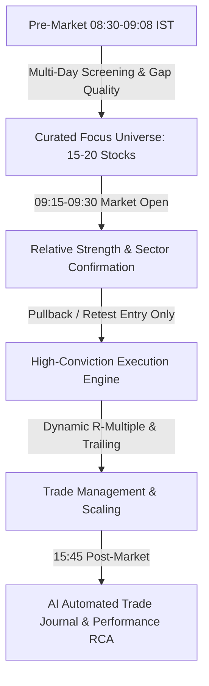

# PulseHunter / TradeDashBoard: Master System Improvement & Strategy Roadmap

---

## Executive Diagnostic: Why Current Trades Fail

The user's screenshot reveals the core symptoms of the current engine:
* **MAZDOCK**: BUY @ ₹2064 $\to$ Target @ ₹2065.6 (+₹1.60 gross, **-₹0.83 net** after ₹2.43 charges)
* **TORNTPHARM**: SELL @ ₹4645.9 $\to$ Square-off @ ₹4642.9 (+₹3.00 gross, **-₹2.48 net** after ₹5.48 charges)
* **IREDA**: BUY @ ₹106.81 $\to$ Stop Loss @ ₹106.81 (₹0.00 gross, **-₹0.13 net**)
* **Total Realized P&L**: **-₹2,759.07**

### The 4 Fatal Flaws in Current Execution:
1. **Entering on Momentum Exhaustion (Late Breakout Chasing):**  
   Current C1/ORB breakout rules trigger *after* the initial 15-to-30 minute expansion candle has already closed near its highs. By that time, retail buyers rush in, while institutional algorithms take profit, creating an immediate mean-reversion pullback that triggers the tight ATR stop loss.
2. **Single-Day Myopia (Lack of Multi-Day Context):**  
   Evaluating stocks solely on today's price change and opening 15-minute range ignores whether the stock is breaking out of a multi-day consolidation or merely experiencing a random opening spike with no institutional sponsorship.
3. **Frictional Slaughter (1-Share Sizing vs Fixed Statutory Charges):**  
   Trading 1 share of a ₹2000 or ₹4600 stock means even a profitable move (+₹1.60 to +₹3.00) is completely consumed by statutory fees (STT, GST, NSE turnover fees = ₹2.43 to ₹5.48). Minimum expected gross profit per trade must exceed 5–10x statutory friction.
4. **Target Placed Inside Market Noise:**  
   Setting a target of +1.60 pts on a ₹2064 stock (0.07% move) is well within normal intraday bid-ask spread jitter. Targets must be anchored to meaningful intraday swings (at least 0.8%–1.5%), not micro-ticks.

---

## Complete Multi-Perspective Improvement Blueprint

---

### 1. Trade Generation & Strategy Perspective (Core Engine)

#### A. From "Chasing Breakouts" to "Breakout $\to$ Pullback Entry"
* **The Problem:** Buying the high of a 9:15–9:30 green candle gets trapped in 70% of intraday sessions.
* **The Solution:** Adopt the **ORB Retest / VWAP Confluence Entry**:
  1. **Phase 1 (Breakout Validation):** Stock breaks above Opening Range High (ORH) with RVOL $\ge 2.0x$.
  2. **Phase 2 (Do Not Buy Highs):** Wait for price to pull back to the retest zone (ORH or rising intraday VWAP).
  3. **Phase 3 (Trigger):** Enter only when a 5-minute candle in the retest zone rejects lower prices (bullish hammer, engulfing, or bid-ask delta turning positive).
  4. **Invalidation:** Stop loss is placed structurally below the pullback pivot, giving a 1:2.5 to 1:3 Risk-to-Reward ratio.

#### B. Multi-Day Context Filtering (Eliminating Single-Day Noise)
Never evaluate a stock based on today alone. Filter candidates through 3 multi-day gates:
1. **20-Day Relative Strength (RS) Rank:** Stock must be outperforming NIFTY 50 over the last 5 and 20 days.
2. **Consolidation Breakout / Stage 2 Trend:** Stock's 20-day daily candle structure must show higher highs/lows or contraction before expansion (Bollinger Band Squeeze / Contraction).
3. **Pre-Market Gap Quality Filter:**
   * High Quality: Gaps $\ge 0.7\%$ over a multi-day resistance level on heavy volume.
   * Low Quality / Trap: Gaps $> 3.5\%$ (exhaustion gap) or gaps into major daily overhead supply.

#### C. Position Sizing & Transaction Cost Economics
* Never size trades below a threshold where statutory fees exceed 10% of expected target profit.
* Set capital-based position sizing: e.g., allocating ₹25,000–₹50,000 margin per trade with minimum ₹150–₹300 target gain, rendering ₹5 statutory fees negligible ($< 2\%$ of gross gain).

---

### 2. Pre- & Post-Market AI Agents Perspective

#### A. Pre-Market Intelligence Agent (08:30–09:08 AM IST)
* **Tasks:**
  1. Ingest global cues (GIFT Nifty, US markets, Brent crude, USD/INR).
  2. Ingest NSE pre-open auction data at 09:08 AM (advancing/declining sectors, volume gap leaders).
  3. Narrow the 210-stock universe down to a **Daily Top 15 Watchlist** with clear directional bias (Long Focus vs Short Focus).
  4. Publish a structured Pre-Market Briefing to the dashboard and Telegram:
     * Market Trend Regime (Trend Day vs Rangebound Day).
     * Top 2 Leading Sectors.
     * Top 5 High-Probability Setups with pre-calculated entry pivot levels.

#### B. Post-Market AI Auditor & Journaling Agent (15:45–16:15 PM IST)
* **Tasks:**
  1. Retrieve all executed paper trades of the day from Postgres/SQLite.
  2. For every trade:
     * Measure **MAE (Maximum Adverse Excursion)** and **MFE (Maximum Favorable Excursion)**.
     * Calculate entry efficiency: Did the stock pull back immediately (bad entry timing) or run into profit first?
     * Classify exit quality: Did it hit SL because of market reversal or premature stop placement?
  3. Generate an automated **Daily Performance & RCA Report** outlining:
     * Win Rate & Profit Factor.
     * Strategy attribution (ORB Retest vs VWAP Reclaim vs Momentum).
     * Suggestions for parameter tuning (e.g., widening trailing buffer on high-ATR days).

---

### 3. Application & UI/UX Perspective

#### A. Intraday Dashboard Workflow
* **Focus View vs Universe View:**
  * Keep the 210-stock universe for high-level market breadth and sector heatmap scanning.
  * Add a prominent **"AI Focus Radar"** widget at the top of the Ranking tab highlighting only the top 10 stocks that meet both multi-day RS and intraday volume criteria.
* **Visualizing the Entry Setup:**
  * When a trade trigger fires, the MiniCandlestick / ChartModal should clearly show the **ORH Line**, **VWAP**, **Entry Price**, **Stop Loss**, and **Target** directly on the chart so the setup is visually verifiable at a glance.

#### B. Mobile PWA Ergonomics
* The new 4-tab bar (`Ranking`, `Charts`, `Positions`, `More`) and native slide-up `More` drawer provide clean ergonomics on iPhone/Android.
* Native **Pull-to-Refresh** ensures instantaneous WebSocket resync and state re-hydration when switching apps.
* Persistent NIFTY 50 ticker displaying LTP, points change (`+358.40 pts`), and percentage (`+1.60%`).

---

### 4. Socket & Data Handling Perspective

#### A. Tick Throttling & Delta Batching
* Maintain 100ms decoupled WebSocket broadcast rate.
* Avoid emitting ticks for inactive symbols. Only broadcast deltas when price, volume, or depth imbalance changes.

#### B. Automatic Session Rollover & Liveness Watchdog
* Maintain the automated 08:45 AM headless login flow.
* If WebSocket ping fails for $>15$ seconds, automatically reconnect without requiring user intervention.

---

### 5. Infrastructure & Computational Perspective

#### A. Database Concurrency & Storage
* SQLite `candle_history` stores 20-day 5-minute OHLCV candles locally for sub-millisecond query latency.
* Supabase Postgres manages user authentication, wallet state, and audit logs.
* Use WAL (Write-Ahead Logging) mode on SQLite to ensure concurrent reads never block candle insertions.

#### B. Vectorized Indicator Calculations
* Compute ATR, RSI, and Volume percentiles using NumPy / vectorized slices rather than Python loops on incoming ticks.

---

## Phased Implementation Roadmap

| Phase | Focus Area | Deliverables |
| :--- | :--- | :--- |
| **Phase 1** | **Strategy Execution Engine** | Replace raw breakout triggers with ORB Retest & VWAP Confluence; implement dynamic position sizing based on minimum ₹25,000 notional value to eliminate statutory charge drag. |
| **Phase 2** | **Multi-Day Context Engine** | Integrate 20-day historical RS and sector tailwind filters into candidate qualification before any signal is evaluated. |
| **Phase 3** | **Pre- & Post-Market AI Agents** | Automated pre-market focus list generation at 09:08 AM and automated post-market trade autopsy report at 15:45 PM. |
| **Phase 4** | **Trade Visualizer & Alerts** | In-app visual trade overlay showing entry pivots, stop levels, and target paths on live charts. |
